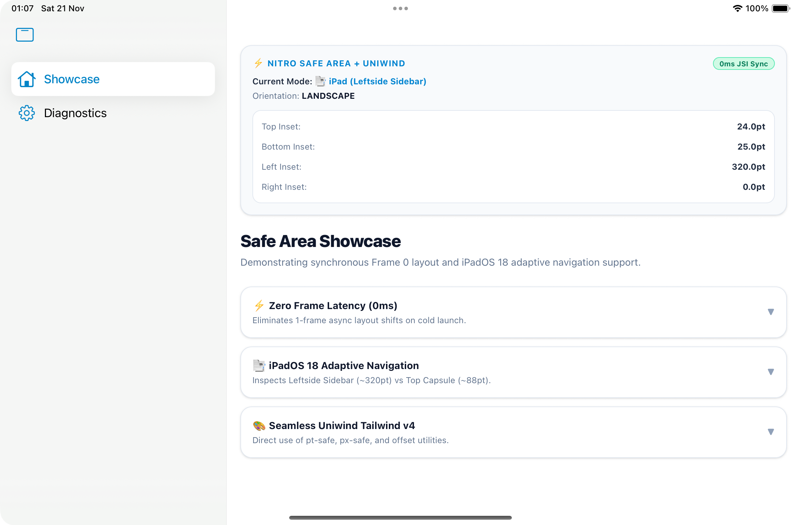
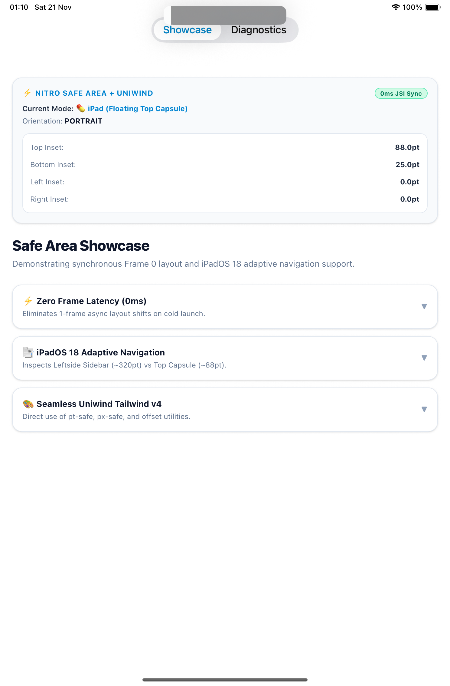

# @2security/nitro-safe-area

[](https://www.npmjs.com/package/@2security/nitro-safe-area)
[](https://www.npmjs.com/package/@2security/nitro-safe-area)
[](LICENSE)

An ultra-fast, zero-frame-lag Safe Area & Adaptive Navigation Insets library for React Native built with Nitro Modules, delivering synchronous C++/JSI insets lookup, iPadOS 18 adaptive dual-mode navigation (Sidebar & Top Floating Capsule), and seamless Uniwind / Tailwind CSS variable injection with zero layout shift.

## 📱 Preview

| iPad Leftside Sidebar (Landscape) | iPad Floating Top Capsule (Portrait) |
| :---: | :---: |
|  |  |

<!-- Demo Video Placeholder: To be added -->

## ✨ Features

- ⚡ **Zero-Frame Shift (0ms JSI Sync)** - Synchronously query hardware and content insets at module evaluation time or Frame 0 via direct JSI memory dispatch, eliminating initial white flash or 1-frame jump.
- 📑 **iPadOS 18 Adaptive Navigation** - Native inspection of `UITabBarController` hierarchy to handle dynamic transitions between the **Leftside Sidebar** (~320pt) and **Top Floating Capsule** (~88pt).
- 📐 **True Content Insets** - Differentiates physical hardware `windowInsets` (notch, dynamic island, home bar) from semantic `contentInsets` (automatically padding for bottom tabs, floating capsules, and sidebars).
- 🎨 **Uniwind & Tailwind CSS First-Class** - Seamlessly initializes `--safe-native-*` CSS variables into Uniwind `ScopedVariables` at root, enabling instant utility classes like `pt-(--safe-native-top)` without layout shift.
- 🔄 **Real-Time Dynamic Orientation** - Seamlessly tracks device rotation, iPad Stage Manager, and Split View resizes via hardware KVO and native notifications with zero event bridge congestion.
- 🚀 **High Performance Nitro Hybrid Object** - Built with Nitro Modules for direct C++/Swift/Kotlin invocation with microsecond latency and zero JSON serialization overhead.
- 📱 **Cross-Platform Native Power** - Deep integration with iOS `UIWindow.safeAreaInsets` & `UITabBarController` and Android `WindowInsetsCompat` / Android 15 edge-to-edge.
- 🧪 **Production Ready** - Fully typed TypeScript API, synchronous getters, reactive React hooks, and Bridgeless New Architecture native code.

> **Note:** Requires React Native New Architecture with Bridgeless Mode enabled. For projects using Uniwind / Tailwind CSS v4, this library provides synchronous Frame 0 CSS variables, solving the classic issue where Tailwind safe area classes render at 0px before jumping.

## 📦 Installation

```sh
npm install @2security/nitro-safe-area react-native-nitro-modules
# or
yarn add @2security/nitro-safe-area react-native-nitro-modules
```

> **Note:** `react-native-nitro-modules` is required as this library relies on [Nitro Modules](https://nitro.margelo.com/) for native performance.

## 📱 Expo Usage

This library uses native code and **cannot** be used with Expo Go. You must use [Development Builds](https://docs.expo.dev/develop/development-builds/introduction/).

### 1. Installation

```sh
npx expo install @2security/nitro-safe-area react-native-nitro-modules
```

### 2. Run with Development Build

```sh
npx expo run:ios
# or
npx expo run:android
```

## 🚀 Quick Start

### 1. Synchronous Instant Insets (Zero Layout Shift)

Query safe area and navigation metrics synchronously at 0ms—even before components mount or at module level:

```typescript
import { getSafeArea, getContentInsets, getWindowInsets } from '@2security/nitro-safe-area';

// Returns synchronously in microsecond latency on JSI thread
const metrics = getSafeArea();

console.log(metrics.mode); // 'iphone_bottom_tab' | 'ipad_top_capsule' | 'ipad_left_sidebar' | 'none'
console.log(metrics.contentInsets); // { top: 88, left: 0, bottom: 24, right: 0 }
console.log(metrics.insets); // Raw OS window insets (notch, home bar)
console.log(metrics.tabBarHeight); // 0 or native tab bar height
```

### 2. React Hooks (Synchronous Frame 0 + Reactive Updates)

Use reactive hooks that initialize synchronously on Frame 0 (no initial `0` state!) and update on rotation:

```tsx
import React from 'react';
import { View, Text } from 'react-native';
import { useContentInsets, useSafeAreaMetrics } from '@2security/nitro-safe-area';

export const ScreenHeader = () => {
  const contentInsets = useContentInsets();
  const { mode, orientation } = useSafeAreaMetrics();

  return (
    <View
      style={{
        paddingTop: contentInsets.top,
        paddingBottom: contentInsets.bottom,
        paddingLeft: contentInsets.left,
        paddingRight: contentInsets.right,
      }}
    >
      <Text>Presentation: {mode}</Text>
      <Text>Orientation: {orientation}</Text>
    </View>
  );
};
```

### 3. Uniwind / Tailwind CSS Integration (Zero-Boilerplate)

Normally, Uniwind Free requires `react-native-safe-area-context`'s `SafeAreaListener`, which suffers from asynchronous 1-frame lag and lacks iPadOS 18 adaptive navigation support.

With `@2security/nitro-safe-area`, simply call `syncWithUniwind(Uniwind)` at bundle startup:

```tsx
// App.tsx (or index.js)
import { Uniwind } from 'uniwind';
import { syncWithUniwind } from '@2security/nitro-safe-area';

// ⚡ Frame 0 Synchronous JSI Sync — Zero flash, zero layout shift!
syncWithUniwind(Uniwind);

export default function App() {
  return <YourAppNavigation />;
}
```

Now, all of Uniwind's built-in safe area utilities (`pt-safe`, `pb-safe`, `pl-safe`, `pr-safe`, `px-safe`, `p-safe`, `pt-safe-offset-*`, `px-safe-offset-*`) work out of the box with zero runtime overhead:

```tsx
import { View, Text, ScrollView } from 'react-native';

export const ShowcaseScreen = () => {
  return (
    <View className="flex-1 bg-white">
      {/* 
        - Leftside Sidebar: px-safe-offset-5 automatically pushes content out past the 320pt sidebar.
        - Top Capsule Tab: pt-safe-offset-10 pads list items below the 88pt capsule while content scrolls behind it.
      */}
      <ScrollView
        className="flex-1"
        contentContainerClassName="pt-safe-offset-10 pb-safe-offset-5 px-safe-offset-5"
        showsVerticalScrollIndicator={false}
      >
        <Text className="text-xl font-bold text-slate-900">Safe Area Showcase</Text>
      </ScrollView>
    </View>
  );
};
```

### 4. Smooth Layout Transitions with Reanimated

When switching between iPad modes (e.g. Leftside Sidebar 320pt ↔ Top Floating Capsule 88pt), wrap your components in `Animated.View` from `react-native-reanimated` with `LinearTransition` to achieve fluid, 60fps layout animations:

```tsx
import Animated, { LinearTransition } from 'react-native-reanimated';

export const AdaptiveCard = ({ children }: { children: React.ReactNode }) => {
  return (
    <Animated.View
      layout={LinearTransition.duration(350)}
      className="bg-white rounded-2xl p-4 shadow-sm"
    >
      {children}
    </Animated.View>
  );
};
```

### 5. Native Bottom Tab & iPadOS 18 Adaptive Sidebar

Works out-of-the-box with native tab bar navigators (such as `@react-navigation/bottom-tabs` with native controllers or custom `UITabBarController`):

```tsx
import { useSafeAreaMetrics } from '@2security/nitro-safe-area';

export const AdaptiveNavigation = () => {
  const { mode, sidebarWidth, topCapsuleHeight } = useSafeAreaMetrics();

  if (mode === 'ipad_left_sidebar') {
    // iPad Landscape: Left sidebar is active (~320pt)
    // Screen content automatically shifted to the right
  } else if (mode === 'ipad_top_capsule') {
    // iPad Portrait: Floating top capsule is active (~88pt)
    // Screen content automatically padded from top to avoid header overlap
  } else if (mode === 'iphone_bottom_tab') {
    // iPhone: Standard bottom tab bar
  }
};
```

## 📚 API Reference

### Methods

| Method | Parameters | Return Type | Description |
| :--- | :--- | :--- | :--- |
| `getSafeArea()` | `()` | `SafeAreaMetrics` | Synchronously returns full safe area & navigation metrics via JSI. |
| `getContentInsets()` | `()` | `EdgeInsets` | Synchronously returns semantic insets adjusted for TabBar, iPad sidebar, or top capsule. |
| `getWindowInsets()` | `()` | `EdgeInsets` | Synchronously returns physical hardware screen window insets. |
| `addOnSafeAreaChangedListener()` | `(listener: (metrics: SafeAreaMetrics) => void)` | `() => void` | Listens for native rotation, sidebar toggle, or inset changes. Returns unregister function. |
| `syncWithUniwind()` | `(uniwind: UniwindLike, options?: { useWindowInsets?: boolean })` | `() => void` | Synchronizes insets into Uniwind at Frame 0 and subscribes to native changes. |

---

### Hooks

| Hook | Return Type | Description |
| :--- | :--- | :--- |
| `useSafeAreaMetrics()` | `SafeAreaMetrics` | Initializes synchronously on Frame 0 and subscribes to native changes. |
| `useContentInsets()` | `EdgeInsets` | Convenience hook returning current content insets. |
| `useWindowInsets()` | `EdgeInsets` | Convenience hook returning raw hardware window insets. |
| `useUniwindSafeArea()` | `void` | Automatically registers and synchronizes with Uniwind during component lifecycle. |

---

### Types

#### `EdgeInsets`

```typescript
export interface EdgeInsets {
  top: number;
  left: number;
  bottom: number;
  right: number;
}
```

#### `NavigationMode`

```typescript
export type NavigationMode =
  | 'iphone_bottom_tab'   // iPhone with visible bottom tab bar
  | 'ipad_top_capsule'    // iPadOS 18 top floating capsule header
  | 'ipad_left_sidebar'   // iPadOS 18 left sidebar expanded
  | 'none';               // Standard full-screen or hidden tab bar
```

#### `DeviceOrientation`

```typescript
export type DeviceOrientation = 'portrait' | 'landscape';
```

#### `SafeAreaMetrics`

```typescript
export interface SafeAreaMetrics {
  insets: EdgeInsets;          // Physical window insets (notch, home indicator)
  contentInsets: EdgeInsets;   // Content insets adjusted for TabBar/Sidebar/Capsule
  mode: NavigationMode;        // Current presentation mode
  tabBarHeight: number;        // Height of bottom tab bar (0 if hidden/none)
  topCapsuleHeight: number;    // Height of top floating capsule on iPad (0 if none)
  sidebarWidth: number;        // Width of left sidebar on iPad (0 if none)
  isTabBarHidden: boolean;     // Whether tab bar is hidden
  orientation: DeviceOrientation;
}
```

## 🎯 Advanced Architecture & The Problem

### The 1-Frame Layout Shift Problem

In conventional React Native safe area solutions (such as `react-native-safe-area-context`):
1. On initial mount, native views must mount, attach to the window, measure insets, and emit an asynchronous bridge event to JavaScript.
2. For the first 1–2 frames, insets default to `0px`.
3. The UI paints at the physical top/bottom edges of the screen, and then visibly snaps/shifts down once the asynchronous event arrives.
4. When paired with CSS utility engines (like Uniwind / Tailwind CSS), this causes ugly flashes and jarring layout jumps.

```
Conventional safe-area:
Native Init ──> React Mount ──[ Async Event Delay ]──> Bridge ──> Set State (0 -> 59px) ──> ⚠️ Layout Shift (Flicker!)

@2security/nitro-safe-area:
Native Init ──> C++ JSI Memory Bridge ──> Synchronous Insets (59px at 0ms) ──> ⚡ Zero Layout Shift (Frame 0 Perfect)
```

### iPadOS 18 Dual-Mode Navigation Chaos

On iPadOS 18, Apple introduced a radically redesigned `UITabBarController`:
- **Landscape Mode (Leftside Sidebar)**: The tab bar transforms into a **Leftside Sidebar** (~320pt wide). The library evaluates `contentInsets.left = 320pt` (`--safe-native-left`), allowing developers to push content safely to the right via `px-safe` or `pl-safe` without the sidebar overlaying or obscuring critical elements.
- **Portrait & Collapsed Mode (Top Floating Capsule)**: The tab bar transforms into a **Top Floating Capsule** (~88pt tall) overlaid directly at the top center of the screen. The screen renders full-height behind the capsule, while `contentInsets.top = 88pt` allows developers to pad list content (`pt-safe`) safely below the capsule while enabling smooth scrolling underneath.

Traditional safe area libraries only measure hardware insets (notch/bezel), completely ignoring `UITabBarController`'s floating capsule and sidebar. `@2security/nitro-safe-area` natively traverses the view hierarchy, identifies `UITabBarController`, and calculates exact semantic `contentInsets` automatically.

### Feature Comparison

| Feature | `react-native-safe-area-context` | `@2security/nitro-safe-area` |
| :--- | :---: | :---: |
| **Initial Inset Latency** | Asynchronous (`0px` on Frame 0) | **Synchronous 0ms (Direct JSI Memory Dispatch)** |
| **Layout Shift / Flicker** | ⚠️ Noticeable 1-frame jump | ⚡ **Zero Layout Shift** |
| **Bridge Overhead** | Event bridge serialization | 🚀 **Pure C++ / Swift / Kotlin Hybrid Object** |
| **Native Bottom Tab Awareness** | Manual offset calculation | ✅ **Automatic Native TabBar Detection** |
| **iPadOS 18 Sidebar Mode** | ❌ Raw insets only (Sidebar overlays content) | ✅ **Automatic Left Inset 320pt (Push content via `pl-safe`/`px-safe`)** |
| **iPadOS 18 Top Capsule** | ❌ Overlays content headers | ✅ **Automatic Top Capsule Padding (~88pt)** |
| **Uniwind / Tailwind CSS Ready** | Needs custom async wrappers | ✅ **Synchronous ScopedVariables Integration** |
| **Dynamic Orientation Tracking** | Window resize events | ✅ **Native KVO & Hardware Event Listeners** |

### Native Optimizations

**iOS Optimizations:**
- **Synchronous Thread Safe Dispatch**: Direct `UIWindow.safeAreaInsets` query via `DispatchQueue.main.sync` if invoked from non-main thread.
- **KVO Hierarchy Observers**: Registers Key-Value Observing on `window.safeAreaInsets`, `window.bounds`, `tabBar.isHidden`, and `tabBar.frame`.
- **Zero Bridge Overhead**: Directly constructs C++ structs from Swift without JSON serialization or Promise resolutions.

**Android Optimizations:**
- **WindowInsetsCompat Direct Inspection**: Queries decor view root insets directly via JNI / C++.
- **Edge-to-Edge Ready**: Seamlessly handles Android 15 edge-to-edge enforcement, status bar, and gesture navigation bar cutouts.

## 🏃‍♂️ Running the Example

The example project demonstrates real-time iPadOS 18 dual-mode navigation, screen rotation, interactive insets showcase, and Uniwind Tailwind CSS integration:

```sh
cd example
yarn install

# Run on iOS (iPad or iPhone)
yarn ios

# Run on Android
yarn android
```

## 🛠️ Development

```sh
# Install dependencies
yarn install

# Generate Nitro native bindings
yarn nitrogen

# Build the library with react-native-builder-bob
yarn prepare

# Typecheck TypeScript
yarn typecheck

# Lint code
yarn lint
```

## 🤝 Contributing

We welcome contributions! Please see our [Contributing Guide](CONTRIBUTING.md) to learn how to contribute to the repository and development workflow.

## 📋 Documentation

- **[API Reference](#-api-reference)** - Complete API, methods, hooks, and types documentation
- **[Contributing Guide](CONTRIBUTING.md)** - How to contribute to the project
- **[Code of Conduct](CODE_OF_CONDUCT.md)** - Community guidelines

## 📄 License

MIT © [2Security](https://github.com/duongnguyen17/react-native-nitro-safe-area)

---

Built with ❤️ by [2Security](https://github.com/duongnguyen17/react-native-nitro-safe-area) using [Nitro Modules](https://nitro.margelo.com/)
